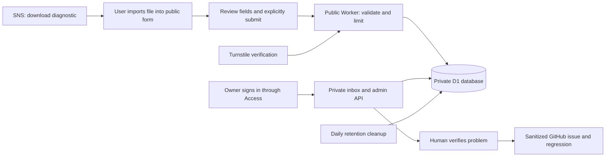

# Cloudflare incorrect-result reporting implementation plan

Prepared October 22, 2026. Status: implementation proposal; nothing deployed.

## 1. Purpose and decisions

Give users a private way to report an incorrect SNS result, automatically organize accepted reports, and give Eniola a manageable review inbox. Turn verified problems into sanitized GitHub issues and regression tests without allowing incoming reports to change sponsorship rules automatically.

Agreed direction:

- Use a web form and Cloudflare services.
- Eniola is the sole initial reviewer.
- Receive and organize reports automatically, with protection against spam and malicious submissions.
- Keep raw submissions private.

The field limits, retention periods, acceptance caps, and operational cadence below are **proposed defaults**, not previously approved policy. Confirm them before accepting real reports. Account configuration, final addresses, and production deployment remain to be completed.

### First-version scope

Build a public form, submission endpoint, private database, owner-only inbox, daily retention cleanup, and an operational runbook. Keep the existing diagnostic download as a fallback.

Defer screenshots, PDFs, general attachments, user accounts, public report lookup, automated reporter emails, AI triage, automatic GitHub issue creation, and employer research. These add cost, maintenance, or privacy exposure without being necessary to receive and resolve reports.

## 2. Existing project behavior and integration boundaries

The starting point is local `master`, version 1.0.1. Existing uncommitted handoff changes must be preserved.

| Existing area | Current behavior | Planned change |
| --- | --- | --- |
| `src/report.ts` | Builds a JSON report and downloads it; no submission | Define a bounded report export, sanitize every URL, add the displayed main decision and role identifier |
| `src/page-ui.ts` | Reason selector and Download report action | Explain the two-step download/import process and add a fixed link to the reporting form |
| `src/main-decision.ts` | Produces the actual headline | Reuse its output in reports; do not change decision rules |
| `src/types.ts` | Scan, interpretation, coverage types | Reuse relevant domain types; add only genuinely shared report types where needed |
| `extension/help.html`, `extension/privacy.html` | Describe download-only reporting | Explain optional web submission, recipients, storage, retention, and fallback |
| `release/public-site/site/support.html`, `privacy.html` | Public support and privacy descriptions | Match the new flow and distinguish local scans from submitted reports |
| `tests/badge.test.ts`, `tests/overview-recovery.test.ts` | Export/privacy regression coverage | Extend sanitization, displayed-result, legacy-format, and size coverage |
| Browser scripts | Existing extension and packaged-release checks | Add report-flow checks while retaining scanner, frame, overview, positioning, accessibility, and privacy coverage |
| `scripts/build.mjs`, `scripts/release-files.mjs`, `scripts/package.mjs` | Build and allowlist extension runtime assets | Keep reporting backend, secrets, and private data outside the extension package |
| `.github/workflows/pages.yml` | Publishes the existing public website | Retain; reporting is a separately deployed service |
| `server/` | Deferred employer-research service | Leave deferred; do not repurpose or reactivate it |

The present export omits full extracted text and form values, but serializes the entire interpretation object, including context quotations and citation source URLs. Only the top-level posting URL is currently stripped of query, fragment, and credentials. We must inspect and minimize the nested data rather than describe the present export as comprehensively sanitized.

The present export also omits the computed headline. Store that headline explicitly in new reports so investigation does not depend on reproducing an old decision using newer code.

Preserve the domain contract in [DECISION_LOGIC.md](../DECISION_LOGIC.md). Reporting must not alter scanning, sponsorship, timing, CPT, OPT, eligibility restrictions, or headline precedence. Opening a form must never send job data automatically.

## 3. Architecture: two small services, one private database

| Piece | Plain-language role | Implementation |
| --- | --- | --- |
| Public form | Reception desk | HTML/CSS and a small script served with a public Cloudflare Worker |
| Submission endpoint | Checks incoming reports | Public Worker validates submissions and writes to D1 |
| Turnstile | Discourages automated submissions | Widget on the form; verification performed by the Worker |
| D1 | Private filing cabinet | One production database for accepted reports, review events, and bounded operational counters |
| Private inbox | Owner's work desk | Separate admin Worker serving the inbox and its API |
| Cloudflare Access | Login gate | Protect the whole admin Worker and verify authenticated identity in its handlers |
| Scheduled cleanup | Deletes expired records | Scheduled handler on the admin Worker |

Use separate public and admin Workers to make their exposed routes and access policies simple. Both require D1 access, so this is an application boundary, not a claim that D1 gives one binding table-level write-only permissions. Public code must implement no report-reading or report-editing routes.



A Worker can serve the form's static assets as well as run its endpoint. We do not need a separate Pages deployment for the reporting form. The existing GitHub Pages site can continue hosting homepage, support, and privacy pages. [Workers static assets](https://developers.cloudflare.com/workers/static-assets/)

### Environment separation

- Local development: local Worker runtime, local D1, fictional reports, Turnstile test keys.
- Staging: separate public/admin Workers, D1 database, challenge keys, and Access application. Synthetic data only; unadvertised public intake still has abuse controls.
- Production: separate database and secrets; final form URL used by the extension.
- Never bind a preview or local test to production D1. Disable unused previews and protect every reachable admin preview/domain.

Start with Cloudflare-provided addresses to avoid a domain purchase. Record the actual public form and admin addresses after setup. Add a custom domain only if desired; it is not required for launch.

## 4. User experience

### From the extension

1. User opens Report incorrect result and selects the problem category.
2. Explain that the diagnostic download stays local, and the web form sends only what they explicitly submit.
3. Keep Download report and add Open reporting form as separate, clearly named actions. Explain that opening the form does not attach or submit the file.
4. Open a fixed HTTPS reporting address in a new tab, without page information in URL parameters, fragments, or referrers.
5. Keep scanning and local download working when the reporting service is offline, capped, or disabled.

Do not POST from content scripts, introduce reporting service permissions, load remote code inside the extension, or add automatic upload on button click. The browser-hosted form runs separately from the packaged extension.

### On the form

1. Offer Import SNS report, accepting bounded JSON only. Parse locally as data; never execute its contents.
2. Show the imported job, scan time, version, displayed result, and exactly which diagnostic fields will be submitted.
3. Ask what was wrong, what result the user expected, and which public passage supports their correction. Tell them not to enter personal application information.
4. Allow editing or removal of imported fields before submission. If diagnostic fields are removed, mark the submission as partial rather than silently presenting it as complete.
5. Support a manual report when export is unavailable, such as a missing badge. Require posting URL, category, and explanation; treat missing diagnostics as an investigation limitation.
6. Offer optional email for follow-up. No sign-in requirement for reporters.
7. Show a concise collection notice and an explicit submission acknowledgement, with the notice version recorded server-side.
8. Complete Turnstile and submit once. Show success only after the database commit succeeds, with a report ID to retain.

Do not upload when a file is selected. Keep the draft in page memory, without localStorage or analytics. On a validation/network failure, retain it in the current page and explain retry steps. Reloading or closing the form can lose an unsent draft; state this plainly. Native file selection, labels, error summaries, keyboard focus, screen-reader status, mobile layout, contrast, and zoom all need verification.

For older report formats, label unavailable fields honestly. Reject unsupported formats with instructions rather than guessing. A submitted file is user-controlled: even an extension version or displayed result can be edited, and must be treated as a claim.

## 5. Data contract and validation

### Proposed fields

| Group | Contents | Trust and handling |
| --- | --- | --- |
| Server identity | Random report ID, received time, schema version, privacy-notice version | Server assigned |
| Reporter explanation | Category, expected outcome, explanation, relevant public passage | User claims, plain text |
| Optional contact | Email address | Private; unverified; never automatically emailed in v1 |
| Posting identity | Sanitized posting URL, title, employer, location, role identifier | Reported identity, not proof of authenticity |
| Diagnostic context | Extension version, scan time, page kind, coverage sources/gaps, warnings | Validated shape; missing fields remain missing |
| Result | Exported main decision and bounded sponsorship/CPT/OPT/restriction findings and citations | Preserve separate concepts; store as reported output |
| Evidence | Bounded exact quotations and source kinds/URLs | Untrusted text; no automatic source fetching |
| Workflow | Status, resolution, severity, duplicate reference, issue link, fixed version | Admin only |
| Retry handling | Random submission key and canonical payload hash | Used to avoid duplicate records after network retries |

Do not collect full DOM, the entire extracted job description, application answers, uploads, resumes, user immigration status, browser history, cookies, settings, stable installation IDs, or browser fingerprints. A short relevant public passage is preferable to an unrestricted full-description field.

### Initial bounds to validate against representative exports

| Item | Proposed limit |
| --- | --- |
| Entire request and imported file | 256 KiB UTF-8 bytes |
| Explanation | 2,000 characters |
| Relevant public passage | 8,000 characters |
| Expected-result explanation | 1,000 characters |
| Title / employer / location / role identifier | 300 characters each |
| URL | 2,048 characters |
| Optional email | 254 characters; sensible syntax validation |
| Diagnostic quotations | At most 40, up to 4,000 characters each, within total byte cap |
| Warnings, context, and other collections | Explicit per-array limits and bounded strings; document each in the schema |

These are application limits, not Cloudflare platform limits. Run real-shaped local exports through the proposed schema before freezing it. Never silently truncate a quote or condition to fit a limit: ask the user to reduce the submission or use the manual form, and flag omitted diagnostics visibly.

Implement server-side allowlisting of every accepted field and nested object, enum checks, finite timestamps, nesting/array/string bounds, and explicit format versions. Do not spread imported JSON directly into stored objects. Reject unexpected fields; allow absence only for documented optional/legacy fields. Use parameterized SQL.

Export a new diagnostic format when adding required semantics; accept the existing format as an explicit legacy adapter. Keep the hosted submission schema version separate from the diagnostic export version so form and extension releases can evolve safely.

### URL handling

- Apply the same sanitization policy in the exporter, form preview, and server. The server remains authoritative.
- Permit only valid HTTP/HTTPS source addresses; remove credentials, query strings, and fragments from all posting and citation URLs.
- Do not infer that removing query strings removes every secret: paths may contain identifiers or personal tokens. Explain this and let the user remove a URL.
- Export a separate role identifier where available because query removal can erase a job ID. Preserve the fact that a sanitized address may no longer reproduce the exact vacancy.
- Do not automatically retrieve submitted links, images, favicons, previews, or employer pages. A reviewer can deliberately open a validated link in a new tab with no opener or referrer.
- Never place email, explanation, diagnostic JSON, or evidence in reporting-page URLs.

## 6. Database structure

Use SQL migrations committed to the repository. Keep JSON for nested diagnostic detail and ordinary columns for fields the inbox filters or sorts.

| Table | Main contents |
| --- | --- |
| `reports` | ID, timestamps, category, status, resolution, severity, identity summary, diagnostic JSON, explanation, public passage, duplicate target, fixed version, issue URL, expiry |
| `report_contacts` | Report ID and optional email, with its own expiry; omit from normal list responses |
| `report_events` | Report ID, event time, authenticated owner identity, status/resolution changes, bounded private notes |
| `intake_counters` | UTC-day accepted-submission count for a strict daily acceptance cap |

Store the retry key/hash on the report with a unique constraint. If implementation needs expiring retry records independently, add a small table only for that concrete requirement. Index inbox ordering, status, expiry, and duplicate-candidate lookup. Paginate lists, for example 25 reports per page; list responses exclude diagnostic bodies and email.

Create the report, optional contact, initial event, and acceptance-counter update atomically. A failed write must not leave a partial report or falsely consume an acceptance slot. Use a conditional counter update and transactional D1 batch/SQL behavior verified by concurrency tests; do not implement the cap as an unlocked read followed by a write.

The database is private and accessed through Worker bindings. Do not expose Cloudflare account tokens, D1 administration APIs, or credentials to the form or extension. Do not assume encrypted storage prevents authorized Cloudflare account holders or our own buggy handlers from reading data: account and application access still require protection.

## 7. Submission processing and abuse controls

### Request sequence

1. Accept only the public submission route and intended method. Apply early route, origin, content-type, and burst checks.
2. Bound the body while streaming, including requests without a trustworthy Content-Length. Reject oversized bodies before fully buffering them.
3. Validate JSON structure and field limits; reject client-supplied workflow/admin fields.
4. Verify Turnstile on the server against the expected hostname and action, using a short outbound timeout. Missing or failed verification stops submission.
5. Sanitize URLs and construct a fresh canonical stored payload. Compute its hash for retries and duplicate suggestions.
6. Resolve safe retries, enforce the daily accepted-report cap, and commit the bounded report transaction.
7. Return a receipt without echoing private content. Never report success before persistence.

Turnstile tokens are single-use and expire after five minutes. A retry after a consumed token requires a fresh challenge. Keep the submission key stable for the same unchanged draft; a repeated key with a different payload is a conflict. A valid retry can return the same report ID without returning report contents or consuming another acceptance slot. [Turnstile validation](https://developers.cloudflare.com/turnstile/get-started/server-side-validation/)

### Layered protections

| Threat | Control | Remaining limitation |
| --- | --- | --- |
| Automated spam | Turnstile plus early burst limiting | Humans and some automated traffic can still pass |
| Bursts from one network | Initial target: 5 attempts/minute per short-lived pseudonymous network key | Shared networks can affect legitimate users; keys are not user identities |
| Distributed accepted spam | Initial cap: 100 newly accepted reports per UTC day, atomically enforced | Attackers can consume the cap and temporarily prevent legitimate intake |
| Platform resource exhaustion | Early rejection, no expensive parsing/fetching, usage monitoring, intake disable switch | Rejected requests can still consume Worker capacity |
| Malformed/large payloads | Bounded streaming and strict nested validation | Valid-shaped false reports remain possible |
| Script/SQL injection | Plain-text rendering, no submitted HTML execution, parameterized queries, CSP | Implementation must be tested |
| Repeated reports | Idempotent retries and duplicate suggestions | Repetition never proves correctness |
| Forged extension reports | Treat every field as a claim; verify public evidence manually | A public extension cannot contain a trustworthy shared secret |
| Tracking or server-side request abuse | No automatic URL fetching, no remote images or previews | Reviewer must still judge links before opening |
| Email abuse | No automated confirmation/follow-up emails in v1 | User-supplied email is not verified |

Cloudflare's rate-limiting binding is approximate and applies per Cloudflare location. It is a burst deterrent, **not** a strict worldwide quota. Use the database transaction for the accepted-report daily cap. Avoid an extra Redis/KV service for this version. [Workers rate limiting](https://developers.cloudflare.com/workers/runtime-apis/bindings/rate-limit/)

If a network key is needed, derive it server-side from Cloudflare-provided network information using a secret-keyed hash and daily scope. Keep it out of report rows and application logs; do not use a plain IP hash or stable visitor identifier. Explain temporary abuse processing in the privacy notice. Verify actual limiter-counter retention before making deletion promises about provider-managed counters.

Enforce same-origin requests on the form API as a browser defense; CORS and Origin checks are not authentication against scripts that call the API directly. No wildcard CORS. A honeypot can be added only as a supplementary, accessible signal, not the primary protection.

Provide an intake-enabled setting checked before expensive work. Disabled or unavailable intake returns a clear temporary-unavailable response with the local-download fallback. Keep the admin inbox available during an intake pause.

## 8. Private inbox and access control

Protect the entire admin Worker with Access. Allow only Eniola's selected sign-in identity; do not allow everyone with an email domain. Secure the Cloudflare account with MFA and recovery information.

Use Worker-level Access protection where available to cover all routes/domains/previews. Validate authenticated identity in handlers using Cloudflare's supported verified identity facility or properly validated signed tokens. Check issuer, audience, signature, expiry, and the owner allowlist; never trust an email header on its own. Missing security configuration must deny access. [Workers Access](https://developers.cloudflare.com/workers/configuration/cloudflare-access/), [token verification](https://developers.cloudflare.com/cloudflare-one/access-controls/applications/http-apps/authorization-cookie/validating-json/)

No production authentication bypass for testing. Test-only identity stubs stay in local tests; deploy checks reject bypass flags and test challenge secrets in production. Cover alternate hosts, preview addresses, encoded paths, trailing slashes, direct API calls, and expired sessions.

Inbox features:

- Paginated list with status, age, category, reported version, and job identity.
- Filters for open reports and category; indexed source/identity lookup for duplicates.
- Detail view contrasting reported output, reported expected result, evidence, and extraction coverage.
- Explicit labels distinguishing user claims from reviewer-verified facts.
- Status, resolution reason, severity, private notes, duplicate link, optional GitHub issue URL, and fixed version.
- View contact separately; export only the selected case when needed. Avoid bulk raw-data export in the first UI.
- Explicit delete/redact action with confirmation and a defined audit behavior.

Protect state-changing requests with same-origin checks and CSRF protection. Use non-GET methods for mutations, bounded inputs, and a revision check to avoid overwriting changes from two open tabs. Apply no-store to private responses, restrict framing, set a restrictive CSP, and render report text using textContent. Allow only validated GitHub issue URLs for issue links.

## 9. Review process and engineering follow-through

Status: `new`, `investigating`, `needs-information`, `closed`.

Resolution on closure: `fixed`, `duplicate`, `expected-behavior`, `unable-to-reproduce`, `insufficient-information`, `out-of-scope`, or `spam`. Severity is separate from status and not assigned by the reporter.

1. Check for private information and redact/delete it promptly. Do not copy raw submissions into GitHub, public logs, test fixtures, or an AI service.
2. Check vacancy identity, source date, extension version, and completeness. A changed or expired posting is a limitation, not proof of a rule failure.
3. Classify the issue: wrong identity, missing extraction, interpretation, citation completeness, UI, unsupported scope, or unclear product rule.
4. Prioritize false blockers, unsupported positive sponsorship statements, leaked information, and wrong-vacancy evidence. Missed blockers and repeated supported-scope extraction problems also need attention.
5. Compare against DECISION_LOGIC.md. A user's expected result is not a replacement for the contract. Policy ambiguities require an explicit product decision and examples before rule changes.
6. For a confirmed bug, prepare a sanitized GitHub issue using repository tracker conventions. Include minimal public evidence, reproduction steps, expected/actual behavior, and version; exclude email, raw report attachment, and unnecessary identifiers.
7. Add a regression that fails for the right reason, fix the shared cause, and run relevant checks. Record the issue and fixed release in the private case.
8. Close with a resolution note. If contact was supplied and a reply is appropriate, Eniola can send a manual response; the system does not send messages automatically in v1.

Duplicate suggestions use sanitized vacancy identity, category, and evidence/output fingerprints; the owner confirms grouping. Different vacancies from the same employer must not be merged as identical reports merely because wording is shared. Do not automatically close or delete duplicate submissions.

Reports used to design rules become development evidence. They must not be scored as an independent holdout. Preserve exact public quotations, provenance, and source date in approved regression examples; preserve scope, timing, exceptions, CPT, OPT, and eligibility distinctions. Existing independent evaluation gates remain unchanged.

Operational default: review the inbox twice weekly, with no public response-time promise. Security/privacy problems should have a separate support contact path. Add an owner digest later only if experience shows it is needed and a delivery provider has been selected.

## 10. Storage, location, retention, and deletion

### Where information lives

| Location | Data |
| --- | --- |
| User's downloads folder | Diagnostic file until the user deletes it; uninstall does not remove it |
| Form tab memory | Unsent draft and imported contents; no draft persistence by default |
| Production D1 | Validated submitted reports, optional contacts, and review history |
| Cloudflare infrastructure | Necessary request/security metadata and recovery copies under provider settings |
| GitHub | Only deliberately sanitized confirmed issues and regression material |
| Owner's device/mailbox | Any deliberate exports or manual correspondence; separately managed and deleted |

Recommend a U.S. D1 jurisdiction for this U.S.-focused project, subject to verifying availability on the chosen plan before creation. A jurisdiction is chosen at database creation; a location hint alone is not a residency guarantee. D1 placement does not imply that Workers, challenge verification, network metadata, or all provider processing remain exclusively in that region. [D1 data location](https://developers.cloudflare.com/d1/configuration/data-location/)

### Proposed retention policy

- Raw submitted content, diagnostic JSON, optional contact, and text notes: expire at the earlier of 90 days after closure or 180 days after receipt. Reopening does not extend the absolute limit.
- Delete spam as soon as classified, with daily cleanup as a fallback. Keep only non-content aggregate counts if useful.
- Unresolved reports nearing the 180-day limit appear in an inbox expiry warning so useful sanitized regressions can be prepared first.
- On expiry, remove related contacts/events/notes and raw duplicate-linked data atomically. Clear affected duplicate references safely; do not leave dangling foreign keys.
- Sanitized issues and public-evidence regressions are separate development records and may remain. They must not retain reporter identifiers or private correspondence.
- Operational counters expire when no longer needed; aggregate non-identifying daily totals may be kept for 90 days. Avoid request-body logging altogether.
- Provide a manual deletion request route through the existing support contact. A report ID helps locate a record but is not sufficient authentication for a public read/delete endpoint. Verify requests proportionately; do not disclose a report to someone merely holding an ID.

Run cleanup daily through a Cron Trigger, in bounded indexed batches. Store last successful cleanup time and counts without deleted content. A failed cleanup is visible in the admin health view; do not claim deletion occurs solely because a row has an expiry timestamp.

D1 Free currently provides seven days of point-in-time recovery. Explain that deleted data may remain recoverable temporarily. Restore only to a controlled environment and reapply expiry rules and a minimal, expiring deletion ledger before exposing recovered data. The ledger contains only random report IDs and deletion times, retained through the recovery window plus a safety margin, not report text or contact information. [D1 recovery](https://developers.cloudflare.com/d1/reference/time-travel/)

Do not promise immediate erasure from provider security logs or backups without verifying their actual policies. Audit logging/observability settings before launch, document actual retention, and ensure production exceptions never log bodies, emails, quotations, Turnstile tokens, or secrets.

## 11. Cloudflare account and general setup

These are setup tasks for implementation, not actions already performed.

1. Create or select an owner-controlled Cloudflare account, secure it with MFA, and record account ownership and recovery steps privately.
2. Confirm Free-plan availability for Workers, D1, Turnstile, and Access in the actual account. Avoid enabling paid products or an automatic upgrade without an explicit owner decision.
3. Choose the account's Workers subdomain and final service names. Use separate names for public/admin and staging/production.
4. Choose the D1 jurisdiction before database creation; create staging and production databases independently.
5. Configure public and admin Worker bindings to the intended environment database. Record IDs in deployment configuration; credentials remain secrets.
6. Create staging and production Turnstile widgets with only the intended form hostnames. Use official test keys for local tests, never production validation bypasses.
7. Create the admin Access application and owner-only policy, configure the chosen sign-in method, and verify unauthorized users are denied.
8. Configure secrets: Turnstile verification secret, network-key hashing secret, and any authentication settings that are actually secret. Public site keys and application identifiers are configuration, not passwords.
9. Apply SQL migrations to staging; deploy both staging Workers; test the complete synthetic workflow and unauthorized access.
10. Configure intake enable/disable controls, acceptance caps, daily cleanup, health reporting, and usage monitoring.
11. Apply reviewed migrations and deploy production services without advertising intake. Run production synthetic smoke checks with test records removed afterward.
12. Publish accurate support/privacy disclosures, then ship the extension link only after the production service passes launch gates.

Start deployments manually through the project's documented commands using scoped credentials. Pin Wrangler in the lockfile and keep server tooling as development dependencies. Do not put broad account API tokens in the repository. If deployment is later automated through GitHub Actions, use separate staging/production secrets and a deliberate production deployment gate; existing GitHub Pages publishing must not deploy the reporting backend accidentally.

## 12. Repository implementation layout

Proposed structure; create only files needed by the implementation:

```text
shared/report-schema.ts             Shared bounded diagnostic/submission contract
reporting/public.ts                 Public form routes and submission handler
reporting/admin.ts                  Protected inbox API and scheduled cleanup
reporting/db.ts                     Small SQL helpers only where genuinely shared
reporting/public/                   Form HTML, CSS, and browser script
reporting/admin/                    Inbox HTML, CSS, and browser script
reporting/migrations/               Versioned SQL migrations
reporting/wrangler.public.jsonc     Public Worker and environment bindings
reporting/wrangler.admin.jsonc      Admin Worker, Access settings, cleanup schedule
reporting/tsconfig.json             Worker-specific types and checks
reporting/README.md                 Setup, deployment, secrets, recovery, operations
tests/report.test.ts                Export/schema/privacy tests
reporting/tests/                    Worker/database and security tests
scripts/browser-reporting.mjs       Local form/inbox and extension integration checks
```

Keep Worker globals/types out of the existing extension TypeScript environment. Update root check scripts to include the reporting typecheck/tests once implemented. Browser bundles must not import server entrypoints or secrets. Do not create a new package/workspace framework merely to separate these files.

Use native Request/Response, Web Crypto, platform bindings, existing TypeScript/Playwright tooling, and plain accessible HTML/CSS. Add Wrangler and the minimum runtime test tooling needed to exercise D1/Workers locally. Use a maintained token-verification dependency if manual JWT verification is required; do not write cryptography to avoid a small justified dependency. No UI framework, ORM, message broker, Redis, or R2 required for the first version.

Add ignores for local Worker state, development secret files, D1 exports, and raw test/report artifacts. Commit examples with placeholder values only. Update `package.json` and lockfile together for any tooling change.

## 13. API behavior and failure handling

| Surface | Behavior |
| --- | --- |
| Public form GET | Static form and public configuration only |
| Public submission POST | Validate, challenge-check, enforce caps, persist, return receipt |
| Public health GET | Minimal availability; no database sizes, identity, or report counts |
| Admin list/detail GET | Authenticated owner only; paginated list and bounded detail |
| Admin update | Authenticated mutation with CSRF/origin and revision checks |
| Admin delete/redact | Authenticated, confirmed, audited without retaining removed private text |
| Admin health GET | Last cleanup success, intake state, aggregate failures and capacity |

Submission outcomes: accepted, invalid fields, oversized payload, failed/expired challenge, rate limited, intake paused, or temporarily unavailable. Use appropriate HTTP statuses and human-readable messages. Never expose SQL errors or stack traces.

If D1 or Turnstile is unavailable, fail safely and keep the current-page draft for retry. Do not silently drop a report or bypass challenge verification. A retry after an uncertain network response must not create a second report. Submission IDs are opaque receipts, not public access tokens.

No diagnostic source fetch is part of submission. The only necessary external verification request is to Cloudflare Turnstile's fixed service. The application should have no arbitrary outbound-fetch feature.

## 14. Free-tier budget and operational limits

Official documentation checked October 22, 2026; recheck at implementation and launch.

| Product | Current relevant Free allowance | Planning consequence |
| --- | --- | --- |
| Workers | 100,000 requests/day; limited CPU time | Keep handlers small; attacks can exhaust availability even without stored reports |
| D1 | 500 MB maximum per database; 5 GB account total; 5 million rows read/day; 100,000 rows written/day | One report database has a 500 MB ceiling, not 5 GB; index and paginate |
| Turnstile | Free plan with unlimited challenges and bounded widget/hostname counts | One production and one staging widget fit the small design |
| Access | Free offering suitable for a small team, subject to account confirmation | Only one reviewer needed; validate actual setup before launch |
| R2 | Not used | No attachment service or metered object-storage dependency in v1 |

Sources: [Workers pricing](https://developers.cloudflare.com/workers/platform/pricing/), [D1 limits](https://developers.cloudflare.com/d1/platform/limits/), [D1 pricing](https://developers.cloudflare.com/d1/platform/pricing/), [Turnstile plans](https://developers.cloudflare.com/turnstile/plans/), [Cloudflare plans](https://www.cloudflare.com/plans/).

At an illustrative 50 KB average, 1,000 reports contain roughly 50 MB before indexes, events, and overhead. At 100 accepted reports/day and 180-day maximum retention, that same average would exceed 500 MB. Therefore the daily cap is abuse protection, not a sustainable storage budget by itself.

Track actual stored size, recent average report size, acceptance rate, write/read use, and cleanup health. Set owner-review thresholds at 50% and 75% of storage/operation limits. Document manual checks if a particular free metric cannot trigger an automatic alert. At 75% storage, pause intake or shorten retention only through a disclosed owner decision; do not wait for writes to fail. Do not silently split reports across databases or enable billing.

Review usage during the initial pilot and weekly thereafter. Keep a documented one-step intake pause and recovery procedure. The Free plan reduces expected cost but does not promise unlimited service, an SLA, or immunity to denial of service.

## 15. Verification strategy

### Unit and contract tests

- New and legacy diagnostic formats, manual reports, missing data, bounded nested fields, and rejection of admin fields.
- Sanitization of every URL, including nested citation URLs and credentials/query/fragment cases.
- Displayed main decision matches `mainDecision` at export time; unavailable legacy output remains explicitly missing.
- No unrelated extraction, form answers, settings, tokens, or stable identifiers in exports/submissions.
- No silent truncation of evidence or conditions.
- Status/resolution rules, contact expiry, duplicate references, and expiry calculations.

### Worker and D1 integration tests

- Use local Cloudflare runtime/database tooling; apply actual migrations.
- Valid submit commits one complete report; database errors commit nothing and never show success.
- Concurrent cap enforcement and retries: no acceptance over the strict cap, no duplicate records, no retry double-counting.
- Oversized chunked request, malformed JSON, unsupported methods, invalid origin, wrong content type, unexpected fields, and missing secrets.
- Turnstile failure, expiry, replay, wrong hostname/action, and timeout.
- Missing/forged/expired/wrong-audience authentication and non-owner identity denied for every admin route.
- CSRF, SQL injection, stored-script payloads, protected exports, no-store, pagination bounds, and unsafe links.
- Cleanup expiry, cascade deletion, duplicate-reference handling, failed cleanup visibility, restore/deletion-ledger behavior.
- No unsolicited source fetch, email, GitHub writes, or body logging.

### Browser and package checks

- Form import previews without network submission; explicit submit sends only reviewed fields.
- Manual reports, partial imports, old-version reports, errors, retry, cap/offline behavior, and honest receipt display.
- Keyboard/screen-reader flow, file-import accessibility, focus/error summaries, mobile/zoom/reduced-motion behavior.
- Owner login, unauthorized denial, list/detail transitions, contact handling, deletion, and session expiry.
- Extension link is fixed, sends no report in the URL/referrer, and leaves local scans/downloads usable offline.
- Run `pnpm check`, affected reporting browser suites, `pnpm test:browser`, `pnpm test:popup`, and extracted-package `pnpm release:verify` before release because the shared panel/report UI changes.
- Verify extension permissions remain unchanged, no remote code or backend secrets are bundled, and merely scanning a vacancy or opening a report draft makes no reporting request.

Local tests use challenge test keys and identity stubs; staging/production smoke checks separately verify real Turnstile and Access. Do not run floods against the public service to test load. Automated fixtures do not establish real-world sponsorship accuracy or replace manual accessibility review.

## 16. Implementation phases and completion gates

| Phase | Work | Completion evidence |
| --- | --- | --- |
| 1. Freeze contract and policy | Confirm fields, size bounds, notices, retention, cap, admin identity, location | Reviewed schema and decisions; fictional sample accepted without sensitive fields |
| 2. Safe diagnostic export | Add displayed decision/identifier, minimize context, sanitize nested URLs, legacy support | Export/privacy regressions pass; current local download remains usable |
| 3. Local submission service | Migrations, validation, local form, Turnstile adapter, transactional retry/cap logic | Real local D1 integration and form tests pass |
| 4. Local private inbox | Authentication boundary, list/detail/update/delete, notes, cleanup | Unauthorized/CSRF tests and review lifecycle pass |
| 5. Cloudflare staging | Account resources, secrets, Access, real challenge verification, synthetic pilot | Both Worker URLs and alternate routes checked; restore and cleanup rehearsed |
| 6. Extension/docs integration | Form link and instructions, help/privacy/support/store disclosures | Extension and packaged-release regressions pass; no background submission |
| 7. Production pilot | Production bindings, security policies, final addresses, unpublished synthetic checks | Owner can submit/review/delete safely; intake pause and recovery verified |
| 8. Release | Final notice and package review, version bump, deploy compatible service, release extension | Exact package verified; rollout checkpoint saved; Store steps performed only when separately authorized |

Do not enable real intake until the inbox, access control, deletion, disclosures, and failure handling are ready. Shipping the form before those controls creates an unmanaged collection channel.

Deploy the backend with compatibility for the previous diagnostic format before releasing the extension. Keep supported old form/API contracts available long enough for already installed extensions. New UI assets use versioned/cache-safe filenames; no browser cache may retain private responses.

Prefer additive database migrations. Roll back Worker versions only to code compatible with the current schema. Pause intake during incidents, preserve the owner's inbox access, and retain the local download fallback. Do not solve rollback by deleting real reports or restoring an older database without reconciling new submissions and deletion requests.

## 17. Launch checklist and owner decisions

Before launch, record these decisions in the setup runbook:

- Actual account owner, public form address, admin address, and sign-in identity.
- Free-plan availability, chosen D1 jurisdiction, account/plan limits, and recovery settings.
- Approval or revisions to 256 KiB requests, 100 accepted reports/day, and initial burst limits.
- Approval or revisions to the 90-day-after-closure / 180-day-absolute retention proposal.
- Whether optional email is included, and how manual correspondence/deletion requests are handled.
- Accurate public privacy notice, processor description, retention exceptions, and contact details.
- Cloudflare log retention/configuration and a tested procedure for avoiding private request-body logs.
- A working support fallback, review cadence, cleanup-health check, capacity checks, and intake pause procedure.
- An owner-verified end-to-end synthetic case, unauthorized-access test, and recovery rehearsal.

Reassess Chrome Web Store disclosures and permission explanations against the final implemented data flow. The current claims describe download-only reports and no developer collection; they must not remain unqualified after web intake exists. Clearly distinguish ordinary local analysis from the user's optional form submission. This plan does not certify policy compliance or authorize public submission.

## 18. Definition of done

A user can knowingly submit a bounded report, receive a reliable receipt, and keep using local SNS analysis even when intake is unavailable. Only the owner can read or manage private reports. Invalid/abusive submissions are constrained, retry behavior is safe, data expires through tested cleanup, and the owner can turn a verified issue into a sanitized regression and tracked fix. Setup and recovery can be followed from the runbook without relying on this conversation.

No implementation, Cloudflare account changes, paid services, deployment, test execution, or Store submission is completed by this planning document.
